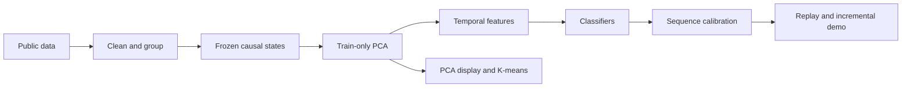

# HS Safety

**Mining Streaming Hidden-State Sequences for Content Safety Detection in Large Language Models**

[中文说明](README.zh-CN.md) · [Reproduction](docs/reproducibility.md) · [Methods](docs/数据挖掘方法与课程对应.md) · [English paper](papers/paper_en.pdf) · [中文论文](papers/paper_zh.pdf)

[](https://github.com/cwxa/hs-safety/actions/workflows/ci.yml)
[](LICENSE)

A reproducible data-mining project for streaming content-safety research. It turns frozen Qwen2.5 hidden-state streams into compact features, compares lightweight classifiers, and connects calibrated risk scores to buffered generation. The supervised task predicts a **complete response's final safety label from its observed prefix**.

## What is included

- **Data mining:** grouped cleaning and overlap audits, train-only incremental PCA, temporal feature engineering, TF–IDF baselines, sequence classification and K-means analysis.
- **Measured comparisons:** two backbone sizes, three fixed seeds, static/history/text baselines, GRU/MLP ablations, held-out calibration and cross-source evaluation.
- **Engineering:** sharded caches with signatures and resume checks; shared offline/online features; an explicit buffer–check–release generation loop.
- **Research artifacts:** aggregate metrics, figure source tables, bilingual IEEEtran manuscripts and source code.



## Results at a glance

The recorded study covers **13,610 eligible responses and 36 fitted detector instances**. Under the common 5% calibration target, the 0.5B static probe reaches **43.7% Recall@128 at 5.60% observed test FPR**; GRU reaches **38.1% at 3.27% FPR**. The 1.5B static probe reaches **54.0% at 5.75% FPR**. These operating profiles support detector selection according to coverage and false-alarm priorities.

See [measured results](results/summary.md), [full metrics](results/metrics.json) and [analysis protocol](docs/experiments.md). Recall@128 includes the true endpoint of shorter responses; the papers also report strict pre-completion diagnostics. Replay states come from the monitoring encoder reading annotated responses.

## Quick start: no model or dataset downloads

Python 3.12 is the tested environment. Clone the repository, then create and activate a virtual environment:

```sh
git clone https://github.com/cwxa/hs-safety.git
cd hs-safety
python -m venv .venv
```

Activate with `.venv\Scripts\Activate.ps1` in PowerShell or `source .venv/bin/activate` on Linux/macOS, then install:

```sh
python -m pip install torch==2.7.0 --index-url https://download.pytorch.org/whl/cpu
python -m pip install -e ".[dev]"
python -m hs_safety --help
python -m pytest -m "not integration" --strict-markers -q
python -m ruff check hs_safety scripts tests
```

The tests use synthetic inputs and tiny randomly initialized models, with network access disabled. For CUDA experiments, install a compatible CUDA PyTorch build instead of the CPU wheel. [requirements.lock](requirements.lock) records the original Windows/Python 3.12/CUDA 12.6 environment; use the project dependencies for other platforms.

## Reproduce the research

Download fixed upstream revisions, then run each stage with the same configuration:

```sh
python scripts/download_assets.py --config configs/main.yaml
python -m hs_safety prepare --config configs/main.yaml
python -m hs_safety validate --config configs/main.yaml
python -m hs_safety extract --config configs/main.yaml
python -m hs_safety train --config configs/main.yaml
python -m hs_safety calibrate --config configs/main.yaml
python -m hs_safety evaluate --config configs/main.yaml
python -m hs_safety demo --config configs/main.yaml
python -m hs_safety report --config configs/main.yaml
```

The main experiment was run on an RTX 3060 Laptop with 6 GB VRAM. `extract` includes raw states, train-only PCA and projected caches. Raw data, per-response predictions, model weights and hidden-state caches are regenerated locally. The optional 1.5B study reuses the main processed splits; follow the [scale instructions](docs/reproducibility.md), without running `prepare` on the scale configuration.

To compile the included manuscripts before regenerating experimental artifacts:

```powershell
./scripts/build_papers.ps1 -SkipReport
```

This uses XeLaTeX/BibTeX. A portable Tectonic alternative and Chinese font setup are documented in [papers/README.md](papers/README.md).

## Repository map

| Path | Purpose |
| --- | --- |
| `hs_safety/` | Data preparation, extraction, features, detectors, evaluation and reporting |
| `configs/` | Fixed main and scale experiments |
| `tests/` | Offline tests for causal features, calibration, caches and buffering |
| `scripts/` | Downloads, validation, paper build and public export |
| `results/` | Aggregate measurements and summaries |
| `papers/` | English/Chinese LaTeX, PDFs, figures and source tables |
| `docs/` | Architecture, protocol, reproduction and course-method mapping |

## Data, licensing and citation

Original project code is [MIT licensed](LICENSE). External datasets and models retain their own terms: BeaverTails is CC BY-NC 4.0; the pinned StreamGuardBench card and Qwen2.5 models declare Apache-2.0. This repository publishes source and aggregate research artifacts; retrieve data and weights from their upstream sources. See [third-party notices](THIRD_PARTY_NOTICES.md) and [public-release scope](docs/open_source.md).

Author: **Weixin Chen (陈纬昕), Nanjing University of Posts and Telecommunications (南京邮电大学)**. Citation metadata are in [CITATION.cff](CITATION.cff).

Contributions follow [CONTRIBUTING.md](CONTRIBUTING.md); please read the [code of conduct](CODE_OF_CONDUCT.md) and [security policy](SECURITY.md).
